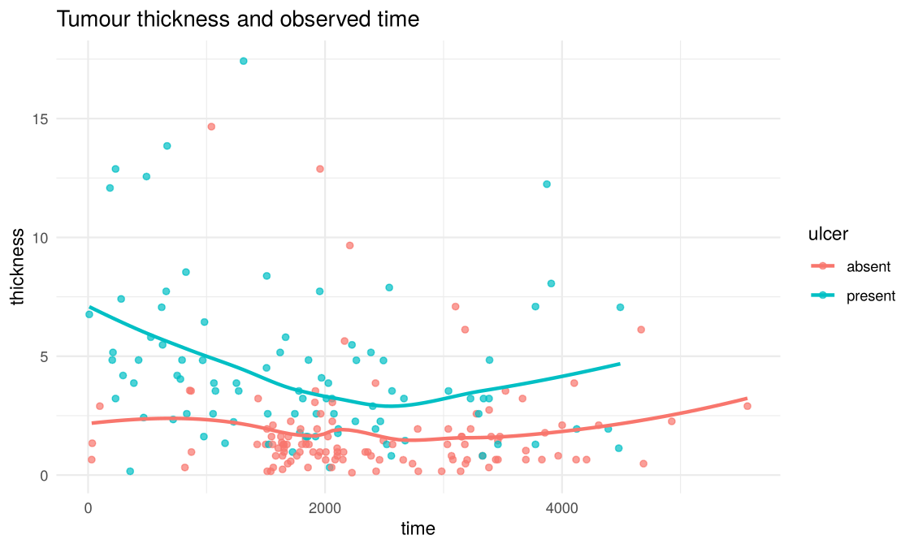

# Melanoma Statistical Analysis in R

[](https://github.com/izzydi/melanoma-statistical-analysis/actions/workflows/r-ci.yml)

An academic statistical-analysis project using the `melanoma` dataset distributed with R's `boot` package.

## Primary workflow

[`melanoma_analysis.Rmd`](melanoma_analysis.Rmd) is the audited source. It combines descriptive analysis, non-parametric comparison, correlation, a stratified logistic-regression example and a regression tree for tumour thickness.

## Results

205 patients from `boot::melanoma`.

**Descriptive findings**

- Ulceration is strongly associated with the outcome: 45.6% of patients with an ulcerated tumour died from melanoma, against 13.9% without ulceration.
- Men had thicker tumours than women (median 2.58 mm vs 1.62 mm; Wilcoxon rank-sum p = 0.004).
- Thicker tumours go with shorter observed follow-up (Spearman ρ = −0.23).



**Logistic regression (melanoma death vs other/alive)**

| Measure | Value |
|---|---|
| Ulceration, odds ratio for melanoma death (training fit) | 3.4 (p = 0.005) |
| Held-out accuracy (51 patients) | 0.725 |
| Majority-class accuracy on the same set | 0.725 |
| Held-out balanced accuracy | 0.589 |
| Sensitivity / specificity for melanoma death | 0.29 / 0.89 |

The model confirms ulceration as the strongest predictor, but it does not beat the majority-class baseline on accuracy and finds 4 of the 14 melanoma deaths in the hold-out set. With five baseline variables and a small sample, that is the honest ceiling of this simple model.

**Regression tree for tumour thickness** (baseline predictors only): held-out RMSE 2.15 mm, MAE 1.43 mm, R² 0.22.

These numbers come from running `melanoma_analysis.Rmd` with R 4.3.3 and caret 6.0-94. The pinned R 4.6.1 environment may give slightly different splits.

## Repository contents

- [`melanoma_analysis.Rmd`](melanoma_analysis.Rmd) — audited R Markdown source.
- [`archive/legacy_assignment.Rmd`](archive/legacy_assignment.Rmd) — original coursework retained for provenance.
- [`figures/`](figures/) — figure shown in the Results section, produced from the analysis's own plotting code.
- [`R-packages.txt`](R-packages.txt) — version-pinned direct R dependencies.
- [`.github/workflows/r-ci.yml`](.github/workflows/r-ci.yml) — R 4.6.1 dependency and syntax CI.
- [`.gitignore`](.gitignore) — local R artifacts.

## Audit improvements

The original assignment contained a spelling error in the outcome recoding and stored `glm_model$coefnames` as if it were the coefficient values. The current source uses `coef(glm_model$finalModel)`, stratifies the hold-out split and documents the important limitation that the historical three-level status variable is simplified to a binary educational endpoint.

The `sex` labels have also been corrected. `boot::melanoma` codes sex as 1 = male and 0 = female, and earlier versions of this analysis had the two labels swapped. The numerical results are unchanged, but sex-related statements now refer to the right group.

The tumour-thickness regression has also been corrected for temporal/post-outcome leakage: follow-up `time` and outcome `status` are no longer used as predictors of tumour thickness. The regression tree now uses only `sex`, `age`, `year` and `ulcer`, which are available at or near baseline.

## Reproducibility and CI

No external dataset is required because the analysis uses `boot::melanoma`. Direct R package versions are pinned in [`R-packages.txt`](R-packages.txt), and GitHub Actions uses R 4.6.1 plus `pak` to install those exact direct versions and parse the canonical R Markdown source.

`R-packages.txt` pins the direct dependencies; it is not a complete `renv.lock` snapshot for every recursive dependency.

## Reproducing the analysis

1. Install R 4.6.1.
2. Install `pak` and the pinned direct dependencies:

```r
install.packages("pak")
pak::pkg_install(readLines("R-packages.txt"), upgrade = FALSE)
```

3. Open `melanoma_analysis.Rmd` in RStudio.
4. Run or knit the document from top to bottom.

## Scope

This is a statistical-programming portfolio project, **not** a clinical decision-support system. The binary outcome used in the modelling section is an explicit analytical simplification and should not be interpreted as a clinical endpoint definition.
